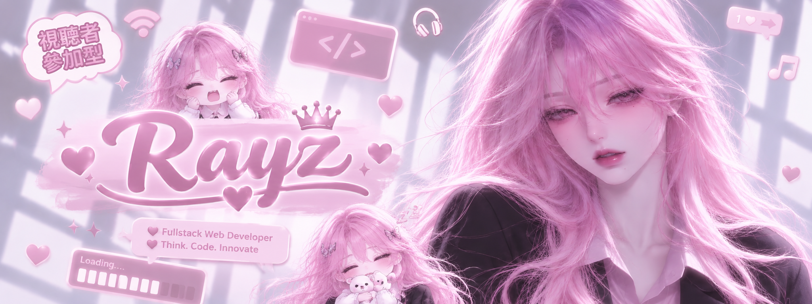

<!-- Animated Capsule Header -->

  

<!-- Welcome Banner Image -->

  

<!-- Animated Typing Introduction -->

 

<!-- Status Badges -->

  
  

<!-- Animated Divider -->

## ✦ About Me & Engineering Philosophy

I'm **Mutiara Joni Legita**, a developer dedicated to building maintainable web applications, expressive frontend experiences, and practical computer vision solutions. I enjoy connecting structured web architectures — from database modeling to responsive user interfaces — with Python-based visual intelligence.

| Focus Area | Current Direction & Engineering Mindset |
| :--- | :--- |
| 🔭 **Currently Building** | Full-stack web portals, interactive components, and applied Computer Vision prototypes. |
| 🌱 **Currently Exploring** | Modern JavaScript (ES6+), reactive UI micro-interactions, and YOLOv8 object detection pipelines. |
| 🧩 **Core Domains** | Full-Stack Web Engineering, UI/UX Systems, and Image Processing. |
| 🤝 **Open To** | Meaningful software collaborations, open-source contributions, and innovative tech projects. |
| ⚡ **Working Principle** | *Think clearly. Build thoughtfully. Keep improving.* — **Think. Code. Innovate.** |

 

<!-- 4 Core Principles Table -->
<table>
  <thead>
    <tr>
      <th width="25%">🧭 01. Understand First</th>
      <th width="25%">🏗️ 02. Clean Architecture</th>
      <th width="25%">✨ 03. Usability as Code</th>
      <th width="25%">🧪 04. Iterative Testing</th>
    </tr>
  </thead>
  <tbody>
    <tr>
      <td>Clarify user workflows, edge cases, and constraints before writing code.</td>
      <td>Design clean modular components and maintainable documentation that scale.</td>
      <td>Treat responsive layouts, accessibility, and smooth motion as core quality.</td>
      <td>Validate CV model precision and interactive UI states through measurable tests.</td>
    </tr>
  </tbody>
</table>

---

## ✧ Technology Stack & Tooling

### 🎨 Frontend, Interface & Styling

  

### ⚙️ Backend, Databases & API

  

### 🤖 AI, Computer Vision & Data

  

### 🛠️ Development Workflow

  

---

## 📊 GitHub Analytics & Metrics

<!-- GitHub Activity Badges (Anti-Broken / 100% Stable) -->
<h3>🚀 GitHub Overview & Activity</h3>

  
  
  

 

<!-- Contribution Snake Animation -->
<h3>🐍 Contribution Graph Animation</h3>
<picture>
  <source media="(prefers-color-scheme: dark)" srcset="https://raw.githubusercontent.com/Platane/snk/output/github-contribution-grid-snake-dark.svg" />
  <source media="(prefers-color-scheme: light)" srcset="https://raw.githubusercontent.com/Platane/snk/output/github-contribution-grid-snake.svg" />
  
</picture>

---

## ⏱️ Coding Activity // WakaTime

---

## ☁ Connect With Me

  

✦ <b>Think. Code. Innovate.</b> — Crafted with precision by Mutiara Joni Legita ✦

<!-- Animated Capsule Footer -->

  

